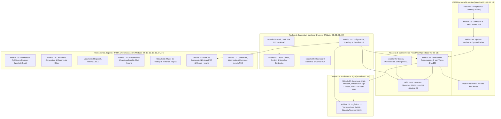

# 📚 Documentación Técnica y Funcional Completa — DAMA-CRM Enterprise

**Plataforma**: DAMA-CRM (Sistema Integral ERP / CRM / SGA / RRHH / BI para PYMES y Empresas)  
**Estándar de Calidad**: 20/20 Módulos verificados End-to-End con Playwright (`--project=chromium`) + Auditoría de Accesibilidad WCAG 2.1 AA (Axe Core).

---

## 🏗️ 1. Arquitectura Global e Interconexión de Módulos

### Reglas Inmutables del Sistema
1. **Identidad Visual y Logotipos Oficiales (`client/public/assets/logos/`)**:
   - Activos inmutables: `dama-logo-dark.png`, `dama-logo-white.png`, `dama-logo-color.png`, `dama-symbol-dark.png`, `dama-symbol-white.png`, `dama-symbol-color.png`.
   - **Lógica de Fallback Universal en PDFs y Vistas**: Si la empresa ha configurado su propio logotipo en `TenantSetting.brandingConfig.logoUrl`, todos los documentos PDF y portales renderizan el logo de la empresa; si no tiene logo propio configurado, el sistema estampa automáticamente el logotipo oficial de DAMA (`dama-logo-dark.png` sobre fondos claros o `dama-logo-white.png` sobre cabeceras oscuras).
2. **Sistema de Diseño Anti-Glare (Modo Claro Descansado)**:
   - Lienzo general en escala Slate/Zinc suave (`#EEF0F3` / `bg-slate-100/90`) que elimina el deslumbramiento de pantallas blancas puras, combinando tarjetas `#FFFFFF` con bordes `border-slate-200` y acentos pastel semánticos.
3. **Posicionamiento Centrado Estricto de Modales**:
   - Todos los diálogos y popups utilizan `fixed inset-0 z-50 flex items-center justify-center p-4 m-auto`, atributos `role="dialog"` y `aria-modal="true"`, y cierre accesible con la tecla `Escape`.

---

## 📦 2. Documentación Detallada Módulo por Módulo (00 al 19)

---

### 🔐 Módulo 00 · Autenticación, RBAC, 2FA & Onboarding
- **Rutas Frontend**: `/login`, `/onboarding`, `/privacy`
- **Componentes Clave**:
  - [`Login.tsx`](file:///C:/Users/Ignacio/Desktop/Proyectos/DAMA-CRM/client/src/pages/Login.tsx)
  - [`Onboarding.tsx`](file:///C:/Users/Ignacio/Desktop/Proyectos/DAMA-CRM/client/src/pages/Onboarding.tsx)
  - [`PrivacyPolicy.tsx`](file:///C:/Users/Ignacio/Desktop/Proyectos/DAMA-CRM/client/src/pages/PrivacyPolicy.tsx)
  - [`AuthContext.tsx`](file:///C:/Users/Ignacio/Desktop/Proyectos/DAMA-CRM/client/src/context/AuthContext.tsx)
- **Controladores & API Backend**:
  - [`auth.controller.ts`](file:///C:/Users/Ignacio/Desktop/Proyectos/DAMA-CRM/server/src/modules/auth/auth.controller.ts) (`POST /api/auth/login`, `POST /api/auth/register`, `GET /api/auth/me`, `POST /api/auth/2fa/setup`, `POST /api/auth/2fa/verify`)
  - [`rbac.middleware.ts`](file:///C:/Users/Ignacio/Desktop/Proyectos/DAMA-CRM/server/src/middlewares/rbac.middleware.ts)
- **Modelos de Base de Datos (`schema.prisma`)**: `User`, `RolePermission`, `AuditLog`
- **Funcionalidades Clave**:
  - Autenticación JWT con contraseñas cifradas mediante `bcrypt`, bloqueo preventivo de fuerza bruta y soporte de doble factor **2FA TOTP (RFC 6238)** compatible con Google Authenticator y Authy.
  - Control de acceso basado en roles (**RBAC**) granular por módulo y acción (`read`, `write`, `delete`, `manage`) para perfiles `ADMIN`, `MANAGER`, `SALES`, `SUPPORT`, `PM` y `USER`.
  - Asistente de Onboarding inicial y paridad completa en 12 idiomas (`es`, `ca`, `en`, `fr`, `de`, `it`, `pt`, `ar`, `zh`, `ja`, `ru`).
- **Verificación Playwright E2E**: [`e2e/module-00-auth-rbac.spec.ts`](file:///C:/Users/Ignacio/Desktop/Proyectos/DAMA-CRM/e2e/module-00-auth-rbac.spec.ts) (**6/6 tests en verde**).

---

### 🧭 Módulo 01 · Layout Global, Navegación, Cmd+K & Modales Globales
- **Rutas Frontend**: Transversal a toda la aplicación (`App.tsx`)
- **Componentes Clave**:
  - [`App.tsx`](file:///C:/Users/Ignacio/Desktop/Proyectos/DAMA-CRM/client/src/App.tsx)
  - [`CommandMenu.tsx`](file:///C:/Users/Ignacio/Desktop/Proyectos/DAMA-CRM/client/src/components/ui/CommandMenu.tsx)
  - [`LanguageModal.tsx`](file:///C:/Users/Ignacio/Desktop/Proyectos/DAMA-CRM/client/src/components/ui/LanguageModal.tsx)
  - [`UserProfileModal.tsx`](file:///C:/Users/Ignacio/Desktop/Proyectos/DAMA-CRM/client/src/components/ui/UserProfileModal.tsx)
  - [`GodModeModal.tsx`](file:///C:/Users/Ignacio/Desktop/Proyectos/DAMA-CRM/client/src/components/ui/GodModeModal.tsx)
  - [`ClockWidget.tsx`](file:///C:/Users/Ignacio/Desktop/Proyectos/DAMA-CRM/client/src/components/employee-portal/ClockWidget.tsx)
- **Funcionalidades Clave**:
  - Barra lateral colapsable organizada por dominios funcionales (Comercial, Operaciones, Finanzas, RRHH, Administración).
  - Paleta de comandos rápida invocada mediante **`Ctrl+K` / `⌘K`** desde cualquier vista para saltar a módulos, buscar registros o cambiar el tema visual (Claro Anti-Glare / Oscuro).
  - Conmutador Multi-Tenant (**God Mode**) para Super-Administradores que permite inspeccionar u operar sobre cualquier organización aislada mediante cabecera `x-switch-tenant-id`.
  - Widget de fichaje rápido en barra superior conectado en vivo con el registro horario del empleado.
- **Verificación Playwright E2E**: [`e2e/module-01-layout-navigation.spec.ts`](file:///C:/Users/Ignacio/Desktop/Proyectos/DAMA-CRM/e2e/module-01-layout-navigation.spec.ts) (**6/6 tests en verde**).

---

### 🏢 Módulo 02 · CRM Core · Directorio de Empresas (Accounts)
- **Rutas Frontend**: `/companies`
- **Componentes Clave**:
  - [`Companies.tsx`](file:///C:/Users/Ignacio/Desktop/Proyectos/DAMA-CRM/client/src/pages/Companies.tsx)
- **Controladores & API Backend**:
  - [`companies.controller.ts`](file:///C:/Users/Ignacio/Desktop/Proyectos/DAMA-CRM/server/src/modules/companies/companies.controller.ts) (`GET /api/companies`, `POST /api/companies`, `PUT /api/companies/:id`, `DELETE /api/companies/:id`)
- **Modelos de Base de Datos**: `Company` (vinculado 1:N con `Contact`, `Deal`, `Invoice`, `Quote`, `Shipment`)
- **Funcionalidades Clave**:
  - Gestión integral de cuentas corporativas con validación de **CIF/NIF/NIE español y VAT europeo**, sector industrial, facturación anual estimada, dirección fiscal y sitio web.
  - Ficha 360º de empresa con visualización directa de sus contactos asociados, oportunidades de venta abiertas y facturación histórica.
  - Filtros combinados por sector, volumen de ingresos, búsqueda en tiempo real y paginación en servidor.
- **Verificación Playwright E2E**: [`e2e/module-02-companies.spec.ts`](file:///C:/Users/Ignacio/Desktop/Proyectos/DAMA-CRM/e2e/module-02-companies.spec.ts) (**7/7 tests en verde**).

---

### 👥 Módulo 03 · CRM Core · Contactos & Lead Capture Hub
- **Rutas Frontend**: `/contacts`, `/lead-capture`
- **Componentes Clave**:
  - [`Contacts.tsx`](file:///C:/Users/Ignacio/Desktop/Proyectos/DAMA-CRM/client/src/pages/Contacts.tsx)
  - [`LeadCapture.tsx`](file:///C:/Users/Ignacio/Desktop/Proyectos/DAMA-CRM/client/src/pages/LeadCapture.tsx)
- **Controladores & API Backend**:
  - [`contacts.controller.ts`](file:///C:/Users/Ignacio/Desktop/Proyectos/DAMA-CRM/server/src/modules/contacts/contacts.controller.ts) (`GET /api/contacts`, `POST /api/contacts`, `PUT /api/contacts/:id`, `DELETE /api/contacts/:id`)
  - [`lead-capture.controller.ts`](file:///C:/Users/Ignacio/Desktop/Proyectos/DAMA-CRM/server/src/modules/lead-capture/lead-capture.controller.ts) (`POST /api/lead-capture/webhook`, `POST /api/lead-capture/form`)
- **Modelos de Base de Datos**: `Contact`, `Activity`
- **Funcionalidades Clave**:
  - Gestión de contactos y prospectos (`isLead`) con segmentación por etiquetas, cargo, empresa vinculada y estado de cualificación.
  - **Lead Capture Hub (`/lead-capture`)**: Generador de formularios web embebibles con consentimiento RGPD explícito y webhooks de entrada para capturar leads automáticamente desde landing pages externas hacia el CRM.
- **Verificación Playwright E2E**: [`e2e/module-03-contacts-leads.spec.ts`](file:///C:/Users/Ignacio/Desktop/Proyectos/DAMA-CRM/e2e/module-03-contacts-leads.spec.ts) (**7/7 tests en verde**).

---

### 📈 Módulo 04 · Pipeline de Ventas, Tablero Kanban & Oportunidades (Deals)
- **Rutas Frontend**: `/pipeline`
- **Componentes Clave**:
  - [`Pipeline.tsx`](file:///C:/Users/Ignacio/Desktop/Proyectos/DAMA-CRM/client/src/pages/Pipeline.tsx)
- **Controladores & API Backend**:
  - [`deals.controller.ts`](file:///C:/Users/Ignacio/Desktop/Proyectos/DAMA-CRM/server/src/modules/deals/deals.controller.ts) (`GET /api/deals/pipeline`, `POST /api/deals`, `PUT /api/deals/:id`, `PATCH /api/deals/:id/stage`, `DELETE /api/deals/:id`)
- **Modelos de Base de Datos**: `PipelineStage`, `Deal`, `Activity`
- **Funcionalidades Clave**:
  - Embudo comercial visual Kanban con **Drag & Drop** fluido y selector rápido de etapa accesible por teclado.
  - Cálculo en vivo de **Valor Total del Pipeline**, **Ingresos Ponderados por Probabilidad de Etapa** (`probability %`), **Tasa de Conversión (Win Rate)** y **Ticket Medio**.
  - Vinculación directa con Empresas (`Company`) y Contactos (`Contact`), fecha estimada de cierre y conversión directa en presupuesto o factura al ganar la oportunidad (`WON`).
- **Verificación Playwright E2E**: [`e2e/module-04-pipeline-deals.spec.ts`](file:///C:/Users/Ignacio/Desktop/Proyectos/DAMA-CRM/e2e/module-04-pipeline-deals.spec.ts) (**8/8 tests en verde**).

---

### 🧾 Módulo 05 · Facturación, Presupuestos, Firma Digital & Cumplimiento Veri\*Factu AEAT
- **Rutas Frontend**: `/invoicing`, `/quote/sign/:id`
- **Componentes Clave**:
  - [`Invoicing.tsx`](file:///C:/Users/Ignacio/Desktop/Proyectos/DAMA-CRM/client/src/pages/Invoicing.tsx)
  - [`VerifactuChainModal.tsx`](file:///C:/Users/Ignacio/Desktop/Proyectos/DAMA-CRM/client/src/components/invoicing/VerifactuChainModal.tsx)
  - [`QuoteSign.tsx`](file:///C:/Users/Ignacio/Desktop/Proyectos/DAMA-CRM/client/src/pages/QuoteSign.tsx)
- **Controladores & Servicios Backend**:
  - [`invoices.controller.ts`](file:///C:/Users/Ignacio/Desktop/Proyectos/DAMA-CRM/server/src/modules/invoices/invoices.controller.ts) (`GET /api/invoices`, `POST /api/invoices`, `GET /api/invoices/:id/pdf`, `GET /api/invoices/verifactu/chain`, `POST /api/invoices/quotes`, `POST /api/invoices/quotes/:id/convert`, `POST /api/invoices/quotes/:id/sign`)
  - [`verifactu.service.ts`](file:///C:/Users/Ignacio/Desktop/Proyectos/DAMA-CRM/server/src/services/verifactu.service.ts)
  - [`pdf.service.ts`](file:///C:/Users/Ignacio/Desktop/Proyectos/DAMA-CRM/server/src/services/pdf.service.ts)
- **Modelos de Base de Datos**: `Invoice`, `InvoiceItem`, `Quote`, `QuoteItem`
- **Funcionalidades Clave y Legalidad**:
  - **Cumplimiento Normativo Veri\*Factu (RD 1007/2023 y Orden HAC/1177/2024)**: Cada factura emitida genera y persiste en PostgreSQL una huella criptográfica **`SHA-256` encadenada** con la factura anterior (`verifactuHash`, `previousInvoiceHash`, `verifactuQrUrl`, `verifactuTimestamp`, `invoiceType`: `F1` Ordinaria, `F2` Simplificada, `R1` Rectificativa).
  - **Auditor de Integridad Criptográfica en Vivo (`VerifactuChainModal`)**: Verifica eslabón por eslabón que ningún registro facturado haya sido alterado, mostrando el hash actual, el hash previo y el enlace de cotejo QR de la AEAT.
  - **Cálculo Fiscal Multirregimen**: Descuentos por línea y globales, IVA (`21%`, `10%`, `4%`, `0%`), IGIC (`7%`) y retención de **IRPF** profesional.
  - **Presupuestos con Firma Manuscrita Digital (`/quote/sign/:id`)**: Enlace público tokenizado con lienzo HTML5 Canvas para firma legal del cliente y conversión en factura oficial en un clic.
- **Verificación Playwright E2E**: [`e2e/module-05-invoicing-quotes.spec.ts`](file:///C:/Users/Ignacio/Desktop/Proyectos/DAMA-CRM/e2e/module-05-invoicing-quotes.spec.ts) (**9/9 tests en verde**).

---

### 💳 Módulo 06 · Gastos, Compras a Proveedores & Control Financiero (P&L)
- **Rutas Frontend**: `/expenses`
- **Componentes Clave**:
  - [`Expenses.tsx`](file:///C:/Users/Ignacio/Desktop/Proyectos/DAMA-CRM/client/src/pages/Expenses.tsx)
  - [`NewExpenseModal.tsx`](file:///C:/Users/Ignacio/Desktop/Proyectos/DAMA-CRM/client/src/components/expenses/NewExpenseModal.tsx)
  - [`EditExpenseModal.tsx`](file:///C:/Users/Ignacio/Desktop/Proyectos/DAMA-CRM/client/src/components/expenses/EditExpenseModal.tsx)
  - [`ExpenseKpis.tsx`](file:///C:/Users/Ignacio/Desktop/Proyectos/DAMA-CRM/client/src/components/expenses/ExpenseKpis.tsx)
  - [`PnLBreakdown.tsx`](file:///C:/Users/Ignacio/Desktop/Proyectos/DAMA-CRM/client/src/components/expenses/PnLBreakdown.tsx)
- **Controladores & API Backend**:
  - [`expenses.controller.ts`](file:///C:/Users/Ignacio/Desktop/Proyectos/DAMA-CRM/server/src/modules/expenses/expenses.controller.ts) (`GET /api/expenses`, `POST /api/expenses`, `PATCH /api/expenses/:id`, `DELETE /api/expenses/:id`, `GET /api/expenses/summary`)
- **Modelos de Base de Datos**: `Expense`
- **Funcionalidades Clave**:
  - Registro y edición de facturas de compra y gastos operativos con NIF/CIF de proveedor, categoría contable, base imponible, cuota de IVA soportado deducible y método de pago.
  - **Cuadro de Mando P&L (Pérdidas y Ganancias) y Liquidación de IVA (Modelo 303)**: Cruza en tiempo real los ingresos facturados (IVA Repercutido) frente a los gastos registrados (IVA Soportado), calculando el Margen Operativo Neto y el saldo fiscal a ingresar o compensar.
- **Verificación Playwright E2E**: [`e2e/module-06-expenses.spec.ts`](file:///C:/Users/Ignacio/Desktop/Proyectos/DAMA-CRM/e2e/module-06-expenses.spec.ts) (**8/8 tests en verde**).

---

### 📦 Módulo 07 · Inventario Multi-Almacén, Traspasos Sage 2 Fases, Lotes FEFO & Kardex Contable
- **Rutas Frontend**: `/inventory`
- **Componentes Clave**:
  - [`Inventory.tsx`](file:///C:/Users/Ignacio/Desktop/Proyectos/DAMA-CRM/client/src/pages/Inventory.tsx)
  - [`SageWarehouseOperations.tsx`](file:///C:/Users/Ignacio/Desktop/Proyectos/DAMA-CRM/client/src/components/inventory/SageWarehouseOperations.tsx)
- **Controladores & Servicios Backend**:
  - [`inventory.controller.ts`](file:///C:/Users/Ignacio/Desktop/Proyectos/DAMA-CRM/server/src/modules/inventory/inventory.controller.ts) (`GET /api/inventory/warehouses`, `POST /api/inventory/transfers`, `POST /api/inventory/transfers/:id/receive`, `GET /api/inventory/transfers/:id/pdf`, `GET /api/inventory/batches`, `GET /api/inventory/kardex`)
  - [`transfer-pdf.service.ts`](file:///C:/Users/Ignacio/Desktop/Proyectos/DAMA-CRM/server/src/services/transfer-pdf.service.ts)
- **Modelos de Base de Datos**: `Product`, `Warehouse`, `WarehouseStock`, `StockTransfer`, `StockTransferItem`, `StockBatch`, `StockMovement`
- **Funcionalidades Clave y Legalidad UE/España (Metodología Sage 50 / Sage 200)**:
  - **Arquitectura Multi-Almacén**: Gestión diferenciada de almacenes centrales, delegaciones regionales y furgonetas SAT (`ALM-MAD-01`, `ALM-BCN-02`, `ALM-SEV-03`, `FURG-TEC-01`) con ubicaciones por pasillo/estantería (`binLocation`) y stock comprometido/en tránsito.
  - **Traspasos entre Almacenes en 2 Fases (Estándar Sage)**:
    - **Fase 1 (Expedición / Salida a Tránsito)**: Descuenta las unidades del `availableStock` del almacén origen y las bloquea contablemente en `inTransitStock` del almacén destino, generando un documento con estado `IN_TRANSIT`.
    - **Fase 2 (Recepción y Verificación en Destino)**: El almacén receptor confirma las unidades recibidas (`receivedQty`). Si existen roturas o diferencias en el transporte, el sistema registra automáticamente un asiento de merma (`SHRINKAGE`) en el Libro Mayor Kardex y consolida las unidades válidas en `availableStock` (`COMPLETED` o `PARTIAL_SHRINKAGE`).
  - **Albarán de Circulación Interno Oficial PDF (`transfer-pdf.service.ts`)**: Cumple con el **Art. 9.1º de la Ley 37/1992 del IVA** (operación interna asimilada no sujeta a IVA por no existir transmisión de propiedad entre el mismo NIF) y con la **Orden FOM/2861/2012 (LOTT)** incluyendo datos obligatorios de cargador, almacén de carga y descarga, transportista, conductor, DNI, matrícula del vehículo, bultos, peso bruto en kg y firmas de expedición/recepción.
  - **Trazabilidad por Lotes/Series FEFO y Libro Mayor Kardex PMP**: Control de fechas de caducidad (*First Expired, First Out*) y valoración de inventario por **Precio Medio Ponderado (Norma de Registro y Valoración 10ª del Plan General de Contabilidad)**.
- **Verificación Playwright E2E**: [`e2e/module-07-inventory-warehouses.spec.ts`](file:///C:/Users/Ignacio/Desktop/Proyectos/DAMA-CRM/e2e/module-07-inventory-warehouses.spec.ts) (**3/3 tests en verde**).

---

### 🚚 Módulo 08 · Logística, 22 Agencias con Logos SVG, Comparador de Tarifas & Etiqueta Térmica 10x15
- **Rutas Frontend**: `/logistics`
- **Componentes Clave**:
  - [`Logistics.tsx`](file:///C:/Users/Ignacio/Desktop/Proyectos/DAMA-CRM/client/src/pages/Logistics.tsx)
  - [`CarrierLogo.tsx`](file:///C:/Users/Ignacio/Desktop/Proyectos/DAMA-CRM/client/src/components/logistics/CarrierLogo.tsx) + 22 logotipos vectoriales en `client/public/assets/carriers/`
- **Controladores & API Backend**:
  - [`logistics.controller.ts`](file:///C:/Users/Ignacio/Desktop/Proyectos/DAMA-CRM/server/src/modules/logistics/logistics.controller.ts) (`GET /api/logistics/shipments`, `POST /api/logistics/shipments`, `POST /api/logistics/rates/compare`, `GET /api/logistics/shipments/:id/label`)
- **Modelos de Base de Datos**: `Shipment`, `ReturnRMA`
- **Funcionalidades Clave**:
  - **22 Agencias de Transporte Integradas con Identidad Visual Oficial**: Correos, Correos Express, SEUR, MRW, GLS, NACEX, TIPSA, Zeleris, Envialia, CTT Express, DHL, UPS, FedEx, TNT, DPD, Mondial Relay, InPost, Sending, Ontime, CBL Logística, Transaher y Rhenus Logistics.
  - **Comparador Inteligente de Tarifas Multi-Agencia**: Cotiza en tiempo real el coste y tiempo de tránsito estimado (24h Urgente, 48/72h Estándar, Frío, Internacional) según peso y destino.
  - **Generador de Etiquetas Térmicas Homologadas 10x15 cm (DIN A6 PDF)**: Genera etiquetas listas para impresoras Zebra/TSC con código de barras **Code-128**, código QR de tracking, remitente con logotipo de empresa (o placeholder oficial DAMA), destinatario, bultos y peso.
  - Gestión completa de **Devoluciones e Incidencias RMA** (`ReturnRMA`).
- **Verificación Playwright E2E**: [`e2e/module-08-logistics-carriers.spec.ts`](file:///C:/Users/Ignacio/Desktop/Proyectos/DAMA-CRM/e2e/module-08-logistics-carriers.spec.ts) (**3/3 tests en verde**).

---

### 📋 Módulo 09 · Planificador Ágil, Tableros Scrum/Kanban, Sprints & Diagrama de Gantt
- **Rutas Frontend**: `/agile`, `/planner`
- **Componentes Clave**:
  - [`AgileBoard.tsx`](file:///C:/Users/Ignacio/Desktop/Proyectos/DAMA-CRM/client/src/pages/AgileBoard.tsx)
  - [`ProjectPlanner.tsx`](file:///C:/Users/Ignacio/Desktop/Proyectos/DAMA-CRM/client/src/pages/ProjectPlanner.tsx)
- **Controladores & API Backend**:
  - [`projects.controller.ts`](file:///C:/Users/Ignacio/Desktop/Proyectos/DAMA-CRM/server/src/modules/projects/projects.controller.ts) (`GET /api/projects`, `POST /api/projects`, `POST /api/projects/:id/tasks`, `PATCH /api/projects/tasks/:taskId`, `POST /api/projects/:id/sprints`, `GET /api/projects/planner-state`, `PUT /api/projects/planner-state`)
- **Modelos de Base de Datos**: `Project`, `Sprint`, `Task`, `TaskComment`
- **Funcionalidades Clave**:
  - Tablero Scrum/Kanban (`/agile`) con columnas `TODO`, `IN_PROGRESS`, `REVIEW` y `DONE`, estimación en **Story Points**, control de horas estimadas vs imputadas (`loggedHours`), prioridades y comentarios técnicos por tarea.
  - Planificador de Proyectos (`/planner`) con **Cronograma Gantt**, gestión de Sprints, retrospectivas, notas de ingeniería y plantillas de lanzamiento persistidas en PostgreSQL.
- **Verificación Playwright E2E**: [`e2e/module-09-agile-planner.spec.ts`](file:///C:/Users/Ignacio/Desktop/Proyectos/DAMA-CRM/e2e/module-09-agile-planner.spec.ts) (**2/2 tests en verde**).

---

### 📅 Módulo 10 · Calendario Corporativo & Reserva de Citas
- **Rutas Frontend**: `/calendar`, `/appointments`
- **Componentes Clave**:
  - [`CalendarView.tsx`](file:///C:/Users/Ignacio/Desktop/Proyectos/DAMA-CRM/client/src/components/planner/CalendarView.tsx)
- **Controladores & API Backend**:
  - [`activities.controller.ts`](file:///C:/Users/Ignacio/Desktop/Proyectos/DAMA-CRM/server/src/modules/activities/activities.controller.ts) (`GET /api/activities`, `POST /api/activities`, `PUT /api/activities/:id`, `DELETE /api/activities/:id`)
- **Modelos de Base de Datos**: `Activity` (vinculado a `User`, `Contact`, `Deal`)
- **Funcionalidades Clave**:
  - Agenda corporativa mensual/semanal que unifica llamadas comerciales, reuniones de cierre, demostraciones de producto y vencimientos de tareas.
  - Creación rápida de citas en modal centrado con asignación de contacto/oportunidad y sincronización bidireccional con Google Calendar.
- **Verificación Playwright E2E**: [`e2e/module-10-calendar-appointments.spec.ts`](file:///C:/Users/Ignacio/Desktop/Proyectos/DAMA-CRM/e2e/module-10-calendar-appointments.spec.ts) (**2/2 tests en verde**).

---

### 🛟 Módulo 11 · Helpdesk, Sistema de Tickets & Gestión de SLA
- **Rutas Frontend**: `/tickets`
- **Componentes Clave**:
  - [`Tickets.tsx`](file:///C:/Users/Ignacio/Desktop/Proyectos/DAMA-CRM/client/src/pages/Tickets.tsx)
- **Controladores & API Backend**:
  - [`tickets.controller.ts`](file:///C:/Users/Ignacio/Desktop/Proyectos/DAMA-CRM/server/src/modules/tickets/tickets.controller.ts) (`GET /api/tickets`, `POST /api/tickets`, `PATCH /api/tickets/:id`, `POST /api/tickets/:id/replies`, `DELETE /api/tickets/:id`)
- **Modelos de Base de Datos**: `Ticket`, `TicketReply`
- **Funcionalidades Clave**:
  - Centro de Atención al Cliente y Soporte Técnico con numeración correlativa (`TKT-XXXX`), niveles de severidad (`LOW`, `MEDIUM`, `HIGH`, `URGENT`) y seguimiento de **SLA** con alertas visuales de vencimiento.
  - Modal centrado de inspección de ticket con hilo de conversación completo, alternancia entre **Respuesta Pública al Cliente** y **Nota Interna de Ingeniería** (`isInternal`), asignación de agente y cambio de estado (`OPEN`, `IN_PROGRESS`, `RESOLVED`, `CLOSED`).
- **Verificación Playwright E2E**: [`e2e/module-11-tickets-helpdesk.spec.ts`](file:///C:/Users/Ignacio/Desktop/Proyectos/DAMA-CRM/e2e/module-11-tickets-helpdesk.spec.ts) (**2/2 tests en verde**).

---

### 💬 Módulo 12 · Omnicanalidad (WhatsApp Meta Cloud / Email) & Chat Interno de Equipo
- **Rutas Frontend**: `/omnichannel`
- **Componentes Clave**:
  - [`Omnichannel.tsx`](file:///C:/Users/Ignacio/Desktop/Proyectos/DAMA-CRM/client/src/pages/Omnichannel.tsx)
- **Controladores & API Backend**:
  - [`omnichannel.controller.ts`](file:///C:/Users/Ignacio/Desktop/Proyectos/DAMA-CRM/server/src/modules/omnichannel/omnichannel.controller.ts) (`GET /api/omnichannel/messages`, `POST /api/omnichannel/send`, `GET /api/omnichannel/team-channels`, `POST /api/omnichannel/team-channels`, `POST /api/omnichannel/team-channels/:id/messages`)
- **Modelos de Base de Datos**: `Message`, `TeamChannel`, `TeamMessage`
- **Funcionalidades Clave**:
  - **Bandeja de Entrada Unificada Externa**: Centraliza conversaciones de **WhatsApp Business (Meta Cloud API)**, **Correo Electrónico (SMTP/IMAP)** y **SMS** vinculadas a la ficha del contacto CRM, con plantillas rápidas de respuesta.
  - **Chat Interno de Equipo (Estilo Slack)**: Canales temáticos por departamento (`#general`, `#ventas-enterprise`, `#soporte-n2`) y mensajes directos persistidos en PostgreSQL (`TeamChannel` y `TeamMessage`).
- **Verificación Playwright E2E**: [`e2e/module-12-omnichannel.spec.ts`](file:///C:/Users/Ignacio/Desktop/Proyectos/DAMA-CRM/e2e/module-12-omnichannel.spec.ts) (**2/2 tests en verde**).

---

### ⚡ Módulo 13 · Flujos de Trabajo & Automatizaciones (Motor de Reglas Event-Driven)
- **Rutas Frontend**: `/workflows`
- **Componentes Clave**:
  - [`Workflows.tsx`](file:///C:/Users/Ignacio/Desktop/Proyectos/DAMA-CRM/client/src/pages/Workflows.tsx)
- **Controladores & API Backend**:
  - [`workflows.controller.ts`](file:///C:/Users/Ignacio/Desktop/Proyectos/DAMA-CRM/server/src/modules/workflows/workflows.controller.ts) (`GET /api/workflows`, `POST /api/workflows`, `PATCH /api/workflows/:id/toggle`, `POST /api/workflows/:id/trigger`, `DELETE /api/workflows/:id`)
- **Modelos de Base de Datos**: `Workflow`, `WorkflowLog`
- **Funcionalidades Clave**:
  - Motor de reglas automatizadas **Disparador -> Condición -> Acción** (`DEAL_WON`, `LEAD_CREATED`, `INVOICE_OVERDUE`, `STOCK_LOW` -> `CREATE_INVOICE`, `SEND_WHATSAPP`, `CREATE_TASK`, `WEBHOOK_N8N`).
  - Galería de plantillas Enterprise listas para activar en un clic, ejecución manual de prueba en vivo y consola de trazabilidad de ejecuciones (`WorkflowLog`).
- **Verificación Playwright E2E**: [`e2e/module-13-workflows.spec.ts`](file:///C:/Users/Ignacio/Desktop/Proyectos/DAMA-CRM/e2e/module-13-workflows.spec.ts) (**1/1 test en verde**).

---

### 👔 Módulo 14 · Portal del Empleado, RRHH, Nóminas PDF & Control Horario (`Mi Tiempo`)
- **Rutas Frontend**: `/portal-empleado` (alias `/employee-portal`), `/my-time`
- **Componentes Clave**:
  - [`EmployeePortal.tsx`](file:///C:/Users/Ignacio/Desktop/Proyectos/DAMA-CRM/client/src/pages/EmployeePortal.tsx)
  - [`MyTime.tsx`](file:///C:/Users/Ignacio/Desktop/Proyectos/DAMA-CRM/client/src/pages/MyTime.tsx)
  - [`TimeTrackingTab.tsx`](file:///C:/Users/Ignacio/Desktop/Proyectos/DAMA-CRM/client/src/components/employee-portal/TimeTrackingTab.tsx)
  - [`PayrollsTab.tsx`](file:///C:/Users/Ignacio/Desktop/Proyectos/DAMA-CRM/client/src/components/employee-portal/PayrollsTab.tsx)
  - [`DirectoryTab.tsx`](file:///C:/Users/Ignacio/Desktop/Proyectos/DAMA-CRM/client/src/components/employee-portal/DirectoryTab.tsx)
- **Controladores & API Backend**:
  - [`employees.controller.ts`](file:///C:/Users/Ignacio/Desktop/Proyectos/DAMA-CRM/server/src/modules/employees/employees.controller.ts) (`GET /api/employees`, `POST /api/employees`, `GET /api/employees/time-entries`, `POST /api/employees/clock-in`, `POST /api/employees/clock-out`, `POST /api/employees/pause`, `GET /api/employees/payrolls`, `POST /api/employees/payrolls`)
- **Modelos de Base de Datos**: `Employee`, `TimeEntry`, `Payroll`, `LeaveRequest`
- **Funcionalidades Clave y Legalidad Laboral**:
  - **Cumplimiento del Real Decreto-ley 8/2019 de Registro de Jornada**: Fichaje de entrada, pausa (comida/descanso) y salida con geolocalización opcional, modalidad (`OFFICE` Presencial vs `REMOTE` Teletrabajo), cronómetro en tiempo real y exportación legal en CSV para la Inspección de Trabajo.
  - **Directorio de Plantilla y Emisión de Nóminas**: Alta de empleados con número de afiliación a la Seguridad Social, IBAN, tipo de contrato y salario bruto anual.
  - **Recibo Oficial de Salarios (Nómina Española)**: Desglose automático de devengos (Salario Base, Complementos), deducciones del trabajador (**Contingencias Comunes 4.70%**, **Desempleo/FP 1.65%**, **Retención IRPF**) y vista previa de recibo oficial con logotipo corporativo de DAMA.
- **Verificación Playwright E2E**: [`e2e/module-14-employee-portal-time.spec.ts`](file:///C:/Users/Ignacio/Desktop/Proyectos/DAMA-CRM/e2e/module-14-employee-portal-time.spec.ts) (**2/2 tests en verde**).

---

### 🌐 Módulo 15 · Portal Privado de Clientes (Self-Service & Portabilidad RGPD)
- **Rutas Frontend**: `/portal` (alias `/client-portal`)
- **Componentes Clave**:
  - [`ClientPortal.tsx`](file:///C:/Users/Ignacio/Desktop/Proyectos/DAMA-CRM/client/src/pages/ClientPortal.tsx)
- **Controladores & API Backend**:
  - [`omnichannel.controller.ts`](file:///C:/Users/Ignacio/Desktop/Proyectos/DAMA-CRM/server/src/modules/omnichannel/omnichannel.controller.ts) (`GET /api/omnichannel/portal/:companyId`)
  - [`lead-capture.controller.ts`](file:///C:/Users/Ignacio/Desktop/Proyectos/DAMA-CRM/server/src/modules/lead-capture/lead-capture.controller.ts) (`GET /api/lead-capture/tickets`, `POST /api/lead-capture/tickets`, `GET /api/lead-capture/privacy-export`)
- **Funcionalidades Clave**:
  - Área privada de autogestión para clientes con cabecera corporativa que muestra el logotipo personalizado de la empresa o el logotipo oficial blanco de DAMA (`dama-logo-white.png`).
  - **Mis Facturas Disponibles**: Consulta de estado de cuenta mercantil y descarga directa de facturas en PDF.
  - **Soporte Técnico Directo**: Formulario para abrir tickets de incidencia con prioridad y seguimiento en vivo de su estado de resolución.
  - **Derechos de Privacidad & Portabilidad RGPD (Art. 20 RGPD)**: Descarga íntegra en formato JSON estructurado de todos los datos asociados al cliente.
- **Verificación Playwright E2E**: [`e2e/module-15-client-portal.spec.ts`](file:///C:/Users/Ignacio/Desktop/Proyectos/DAMA-CRM/e2e/module-15-client-portal.spec.ts) (**1/1 test en verde**).

---

### 📊 Módulo 16 · Informes Ejecutivos PDF, Libros Oficiales de IVA & Business Intelligence
- **Rutas Frontend**: `/reports`, `/admin-bi`
- **Componentes Clave**:
  - [`Reports.tsx`](file:///C:/Users/Ignacio/Desktop/Proyectos/DAMA-CRM/client/src/pages/Reports.tsx)
  - [`AdminBI.tsx`](file:///C:/Users/Ignacio/Desktop/Proyectos/DAMA-CRM/client/src/pages/AdminBI.tsx)
- **Controladores & Servicios Backend**:
  - [`reports.controller.ts`](file:///C:/Users/Ignacio/Desktop/Proyectos/DAMA-CRM/server/src/modules/reports/reports.controller.ts) (`GET /api/reports/sales`, `GET /api/reports/velocity`, `GET /api/reports/admin-bi`, `GET /api/reports/executive-pdf`, `GET /api/reports/export`)
  - [`report-exporter.service.ts`](file:///C:/Users/Ignacio/Desktop/Proyectos/DAMA-CRM/server/src/services/report-exporter.service.ts)
- **Funcionalidades Clave**:
  - **BI Comercial & Velocidad Ágil (`/reports`)**: Analítica de ingresos ganados, embudo por etapas, ranking de mejores clientes y velocidad de Sprints Scrum.
  - **Exportador de Informe Ejecutivo PDF**: Genera al vuelo un dossier directivo A4 con logotipo corporativo de la empresa (o placeholder oficial DAMA), cajas de KPIs financieros, valoración de inventario y desglose de facturación reciente.
  - **Exportación de Libros Registro de IVA AEAT (Modelo 303)**: Exportación CSV UTF-8 con BOM de Facturas Expedidas (`tax-issued`), Facturas Recibidas/Gastos (`tax-received`), Oportunidades, Contactos, Empresas y Catálogo.
  - **Telemetría de Ecosistema (`/admin-bi`)**: Monitorización en tiempo real de uso de memoria Heap/RSS de Node.js, uptime del servidor, conteo global de entidades en PostgreSQL y feed de auditoría de seguridad (`AuditLog`).
- **Verificación Playwright E2E**: [`e2e/module-16-reports-bi.spec.ts`](file:///C:/Users/Ignacio/Desktop/Proyectos/DAMA-CRM/e2e/module-16-reports-bi.spec.ts) (**2/2 tests en verde**).

---

### 🔌 Módulo 17 · Integraciones, Conectores de Terceros, Webhooks & Centro de Ayuda FAQ
- **Rutas Frontend**: `/integrations`, `/faq`
- **Componentes Clave**:
  - [`Integrations.tsx`](file:///C:/Users/Ignacio/Desktop/Proyectos/DAMA-CRM/client/src/pages/Integrations.tsx)
  - [`ApiConfiguratorModal.tsx`](file:///C:/Users/Ignacio/Desktop/Proyectos/DAMA-CRM/client/src/components/integrations/ApiConfiguratorModal.tsx)
  - [`FAQ.tsx`](file:///C:/Users/Ignacio/Desktop/Proyectos/DAMA-CRM/client/src/pages/FAQ.tsx)
- **Controladores & API Backend**:
  - [`integrations.controller.ts`](file:///C:/Users/Ignacio/Desktop/Proyectos/DAMA-CRM/server/src/modules/integrations/integrations.controller.ts) (`GET /api/integrations`, `PUT /api/integrations/:connector`, `POST /api/integrations/:connector/test`, `POST /api/integrations/test-all`, `POST /api/integrations/:connector/sync`)
- **Funcionalidades Clave**:
  - **Catálogo Enterprise de Conectores (`/integrations`)**: Integración nativa y webhooks bidireccionales con **Odoo ERP**, **WooCommerce**, **Shopify**, **Stripe Payments**, **n8n Workflow Automation**, **Zapier**, **Google Calendar**, **UnoPIM**, **WhatsApp Meta Cloud**, **Holded**, **Slack** y **Mailchimp**.
  - **Auditoría de Handshake & Inspector de Trazas Centrado**: Botón de comprobación de latencia HTTP en vivo, modal centrado de configuración de credenciales protegido por RBAC y modal centrado de **Auditoría & Traza de Logs** por conector.
  - **Centro de Ayuda Interactivo (`/faq`)**: Buscador instantáneo por palabras clave/etiquetas, filtrado por categorías y sistema de valoración de utilidad de respuestas.
- **Verificación Playwright E2E**: [`e2e/module-17-integrations-faq.spec.ts`](file:///C:/Users/Ignacio/Desktop/Proyectos/DAMA-CRM/e2e/module-17-integrations-faq.spec.ts) (**2/2 tests en verde**).

---

### 🎨 Módulo 18 · Configuración, Identidad Corporativa, Logo Placeholder DAMA & Estudio de Diseño PDF
- **Rutas Frontend**: `/settings`
- **Componentes Clave**:
  - [`Settings.tsx`](file:///C:/Users/Ignacio/Desktop/Proyectos/DAMA-CRM/client/src/pages/Settings.tsx)
  - [`PdfDesignSettings.tsx`](file:///C:/Users/Ignacio/Desktop/Proyectos/DAMA-CRM/client/src/components/settings/PdfDesignSettings.tsx)
  - [`BrandingContext.tsx`](file:///C:/Users/Ignacio/Desktop/Proyectos/DAMA-CRM/client/src/context/BrandingContext.tsx)
- **Controladores & Servicios Backend**:
  - [`branding.controller.ts`](file:///C:/Users/Ignacio/Desktop/Proyectos/DAMA-CRM/server/src/modules/branding/branding.controller.ts) (`GET /api/branding`, `PUT /api/branding`, `POST /api/branding/logo`, `GET /api/branding/sample-pdf`)
  - [`pdf.service.ts`](file:///C:/Users/Ignacio/Desktop/Proyectos/DAMA-CRM/server/src/services/pdf.service.ts)
- **Modelos de Base de Datos**: `TenantSetting` (`brandingConfig`, `smtpConfig`, `modulesConfig`)
- **Funcionalidades Clave**:
  - **Identidad de Marca y Subida de Logotipo**: Configuración de nombre comercial, color primario, tipografía y subida de logotipo corporativo con conmutación automática al placeholder oficial de DAMA cuando se restablece o no existe logo propio.
  - **Estudio de Diseño de Documentos & PDF (`PdfDesignSettings.tsx`)**:
    - **4 Plantillas Estructurales**: `MODERN_STRIPE` (Moderna tipo Stripe), `CORPORATE_SAGE` (Corporativa tipo Sage ERP con cajas técnicas), `CLASSIC_EXECUTIVE` (Clásica Ejecutiva) y `MINIMAL_SWISS` (Minimalista Suiza).
    - **Personalización Visual Total**: Color de acento del PDF, color secundario de cabeceras de tabla, posición del logotipo (`LEFT` / `RIGHT`), mostrar/ocultar sello QR Veri\*Factu, cuenta bancaria IBAN, bloque de firma del cliente, marca de agua diagonal, inscripción en el Registro Mercantil y cláusula legal RGPD/LOPDGDD.
    - **Lienzo A4 Interactivo en Tiempo Real**: Vista previa reactiva instantánea que refleja cada cambio de diseño antes de guardar en PostgreSQL o descargar un PDF de muestra real.
  - **Gestión de Usuarios, Matriz de Permisos RBAC, Servidor SMTP, Seguridad 2FA y Copias de Seguridad**.
- **Verificación Playwright E2E**: [`e2e/module-18-settings-pdf-studio.spec.ts`](file:///C:/Users/Ignacio/Desktop/Proyectos/DAMA-CRM/e2e/module-18-settings-pdf-studio.spec.ts) (**2/2 tests en verde**).

---

### 🖥️ Módulo 19 · Dashboard Ejecutivo & Manejo de Errores (404 / ErrorBoundary)
- **Rutas Frontend**: `/` (alias `/dashboard`), `/404` (cualquier ruta no reconocida)
- **Componentes Clave**:
  - [`Dashboard.tsx`](file:///C:/Users/Ignacio/Desktop/Proyectos/DAMA-CRM/client/src/pages/Dashboard.tsx)
  - [`NotFound.tsx`](file:///C:/Users/Ignacio/Desktop/Proyectos/DAMA-CRM/client/src/pages/NotFound.tsx)
  - [`ErrorBoundary.tsx`](file:///C:/Users/Ignacio/Desktop/Proyectos/DAMA-CRM/client/src/components/common/ErrorBoundary.tsx)
- **Funcionalidades Clave**:
  - **Dashboard Ejecutivo Personalizable (`/`)**:
    - 6 bloques modulares reordenables mediante Drag & Drop o controles accesibles de subida/bajada (`kpis`, `cashflow_forecast`, `pipeline_chart`, `recent_tasks`, `top_deals`, `quick_actions`).
    - El orden personalizado de los widgets se persiste automáticamente en la base de datos dentro de las preferencias del usuario (`User.preferences.dashboardWidgets`) y cuenta con botón de restablecimiento al diseño predeterminado.
    - **Previsión de Tesorería (`cashflow_forecast`)**: Cruza cobros confirmados, facturas pendientes de cobro y pipeline ponderado filtrable por período (`Hoy`, `Esta Semana`, `Este Mes`, `Trimestre`, `Año`).
  - **Pantalla Corporativa 404 (`NotFound.tsx`) & `ErrorBoundary`**: Captura cualquier ruta inexistente o fallo de renderizado mostrando una interfaz limpia y centrada con retorno inmediato al panel principal.
- **Verificación Playwright E2E**: [`e2e/module-19-dashboard-errors.spec.ts`](file:///C:/Users/Ignacio/Desktop/Proyectos/DAMA-CRM/e2e/module-19-dashboard-errors.spec.ts) (**2/2 tests en verde**).
