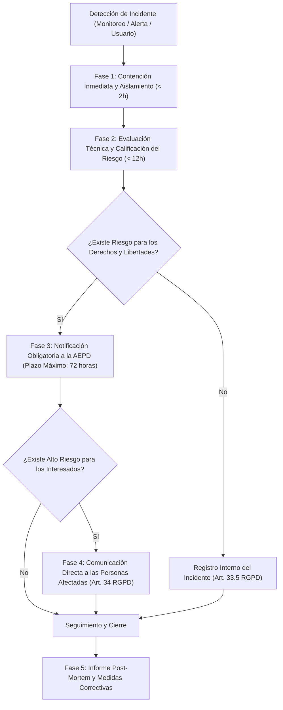

# Protocolo de Gestión de Brechas de Seguridad y Notificación a la AEPD (72h)

> [!IMPORTANT]
> **MARCO REGULATORIO APLICABLE**:
> - **Artículos 33 y 34 del Reglamento General de Protección de Datos (RGPD - UE 2016/679)**.
> - **Directrices 01/2021 del Comité Europeo de Protección de Datos (EDPB)** sobre ejemplos de notificación de brechas de datos.
> - **Guía para la notificación de brechas de seguridad de los datos de la Agencia Española de Protección de Datos (AEPD)**.
> 
> **AVISO**: *REQUIERE VALIDACIÓN de la Dirección de Seguridad / DPO.*

---

## 1. Definición y Alcance

Una **Violación de la Seguridad de los Datos Personales (Brecha de Seguridad)** es todo incidente que ocasione la destrucción, pérdida o alteración accidental o ilícita de datos personales transmitidos, conservados o tratados de otra forma, o la comunicación o acceso no autorizados a dichos datos.

El presente protocolo aplica a todo el personal de **DAMA-CRM**, administradores de sistemas, desarrolladores y empresas clientes (Tenants).

### Tipologías de Brechas:
1. **Brecha de Confidencialidad**: Divulgación o acceso no autorizado a datos (p. ej. filtración de credenciales, inyección SQL, exfiltración por API sin autenticación, fallo IDOR).
2. **Brecha de Integridad**: Alteración no autorizada o accidental de datos personales (p. ej. manipulación fraudulenta de salarios, facturas o registros de jornada).
3. **Brecha de Disponibilidad**: Pérdida de acceso o destrucción accidental/maliciosa de datos (p. ej. ataque de ransomware, fallo catastrófico de almacenamiento sin respaldo inmediato).

---

## 2. Flujo de Respuesta ante Incidentes (Fases de Actuación)

---

## 3. Detalle de Fases Operativas

### Fase 1: Detección y Contención Inmediata (0 - 2 horas)
- **Acciones Técnicas Inmediatas**:
  - Revocación instantánea de tokens JWT comprometidos y forzado de cierre de sesión global.
  - Bloqueo en firewall/WAF de direcciones IP atacantes.
  - Aislamiento del contenedor o nodo afectado de la red si se sospecha compromiso de servidor.
  - Preservación forense de registros (`system_error_logs`, `audit_logs`, logs de acceso de nginx/caddy/docker) sin sobrescribir evidencias.

### Fase 2: Evaluación del Riesgo y Calificación (2 - 12 horas)
El Comité de Seguridad y el DPO evaluarán:
1. **Naturaleza, volumen y sensibilidad de los datos comprometidos**: ¿Se han visto afectados datos bancarios (IBAN), contraseñas, salarios, DNI o datos de menores/salud?
2. **Gravedad de las consecuencias potenciales**: ¿Existe riesgo de suplantación de identidad, fraude financiero, discriminación o daño reputacional grave para los interesados?
3. **Eficacia de las medidas previas de protección**: ¿Estaban los datos cifrados con algoritmos robustos inaccesibles para el atacante?

### Fase 3: Notificación Obligatoria a la AEPD (Límite Estricto: 72 horas)
Conforme al Artículo 33 del RGPD:
- Si la brecha entraña un riesgo para los derechos y libertades de las personas físicas, **se debe notificar formalmente a la AEPD en un plazo no superior a 72 horas** desde que se tenga constancia del incidente.
- **Canal Oficial**: Sede Electrónica de la AEPD a través del trámite telemático habilitado al efecto ([sedeagpd.gob.es](https://sedeagpd.gob.es)).
- **Contenido Mínimo de la Notificación**:
  - Descripción de la naturaleza de la violación de la seguridad, categorías y número aproximado de interesados y registros afectados.
  - Nombre y datos de contacto del Delegado de Protección de Datos (DPO) o de otro punto de contacto donde obtener más información.
  - Descripción de las posibles consecuencias de la violación de la seguridad.
  - Descripción de las medidas adoptadas o propuestas por el responsable para poner remedio a la violación, incluyendo, en su caso, medidas para mitigar posibles efectos negativos.
  - En caso de no poder facilitar toda la información de forma simultánea, se remitirá por fases sin dilación indebida.

### Fase 4: Comunicación a los Interesados (Artículo 34 RGPD)
- Si la violación de seguridad entraña un **alto riesgo** para los derechos y libertades de las personas afectadas (p. ej. exfiltración masiva de credenciales en texto plano o datos bancarios):
  - Se comunicará a los interesados en un lenguaje claro y sencillo, de forma individualizada y directa (correo electrónico / SMS).
  - Se informará de las medidas que pueden adoptar ellos mismos (p. ej. cambiar contraseñas en otros servicios, alertar a sus entidades bancarias).
- **Excepciones a la comunicación**: Cuando los datos afectados estuvieran cifrados de forma ininteligible para cualquier persona no autorizada, o cuando se hayan adoptado medidas posteriores que garanticen que el alto riesgo ya no se materializará.

### Fase 5: Registro Interno de Incidentes (Art. 33.5 RGPD)
Todas las brechas de seguridad —inclusive aquellas que no requieran notificación a la AEPD por carecer de riesgo apreciable— **deben ser documentadas obligatoriamente en el Registro Interno de Incidencias de DAMA-CRM**, haciendo constar los hechos, sus efectos y las medidas correctoras adoptadas.

---

## 4. Equipo de Respuesta ante Incidentes de Ciberseguridad (CSIRT)

- **Coordinador del Incidente**: Responsable de Seguridad / CTO ([security@damacrm.com])
- **Asesor Legal y de Privacidad**: Delegado de Protección de Datos ([dpo@damacrm.com])
- **Líder Técnico de Infraestructura**: Ingeniero DevOps / SRE
- **Portavoz de Comunicación**: Dirección de Comunicación Corporativa
